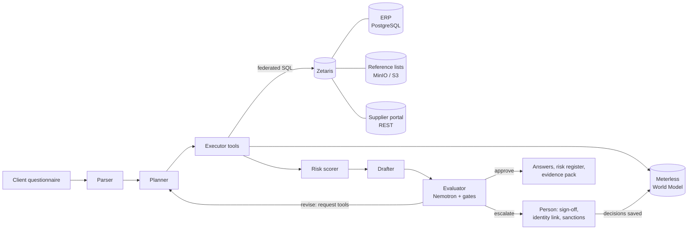

# Reasonable Steps

An agent system that helps small suppliers answer a big client's modern slavery questionnaire with evidence instead of guesses.

Built for the Open Agent Hackathon 2026, Track 2: The Agent That Can Explain Why.

## The problem

Australia's Modern Slavery Act requires large companies (AUD 100 million or more in revenue) to report on modern slavery risks in their supply chains. In July 2026 the government [announced plans](https://www.claytonutz.com/insights/2026/july/new-criminal-offence-for-failure-to-prevent-modern-slavery-on-the-way) to make it a criminal offence for these companies to fail to prevent modern slavery in their supply chains. A company that took "reasonable steps" would have a defence. The details are going to consultation.

Large companies push that work down to their suppliers. A small cleaning business gets a 10-question questionnaire from a property group and has to answer it about its own suppliers. It has no compliance team. Today it answers from memory: "our suppliers are Australian businesses, so no". That answer is usually wrong. The Australian distributor sells nitrile gloves made in Malaysia, and Malaysian rubber gloves are on the US Department of Labor's forced labour list.

Existing tools (Informed 365, Gatekeeper and others) serve the buyer who sends the questionnaire. Nobody does the work for the supplier who has to answer it.

## What it does

Reasonable Steps reads the business's own systems and the public risk lists, checks every purchase, and drafts each answer with the evidence behind it.

- **Federated data through Zetaris.** The ERP (PostgreSQL), the supplier declaration portal (a REST API) and the reference lists (CSV files in S3-compatible storage) are joined in single queries. Only the answer rows reach the agents.
- **A planner, executor, drafter and evaluator loop.** The evaluator sends back drafts that the evidence does not support, and requests the checks that would support them. The planner runs those checks and the drafter tries again.
- **Shared state in the Meterless World Model.** Suppliers, manufacturers, purchase lines, declarations, evidence, findings and answers live in an event-sourced graph with provenance on every write. It persists between runs, so decisions a person makes (an identity link, approved wording) carry forward.
- **NVIDIA Nemotron does the judging.** Nemotron plans the checks, classifies purchase lines the product taxonomy misses, reviews identity links and reviews every draft. The drafter writes from tested templates, so every sentence traces to evidence and no answer is graded by the model that wrote it.
- **Answers you can check.** Every claim cites evidence, every evidence item cites the Zetaris queries that produced it, and every query is kept with its SQL.

### What happens in a run



With the demo data, iteration 1 runs the cheap tier 1 checks and drafts all 10 answers. The evaluator sends 4 back. The draft for question 3 said "we have not identified high-risk goods", but no purchase line had been screened. Iteration 2 resolves supplier identities across the ERP and the portal, screens all 39 purchase lines against the US DOL list by product and origin, checks the inputs named in declarations, and widens the sanctions screen to manufacturers and parent companies. The answer to question 3 changes from "no" to a list of specific goods, suppliers and spend. Two items stop for a person: the owner must approve a commitment, and a portal record with a near-match name needs confirming as the same company.

## Agents and tools

| Agent | Job | Model route (default) |
|---|---|---|
| Parser | Questionnaire (Word, Markdown, text) to structured questions with topics | `MODEL_PARSER` |
| Planner | Chooses tools each iteration, proportionately: tier 1 first, tier 2 when evidence is insufficient | `MODEL_PLANNER` |
| Executor | Runs the tools below as federated queries through Zetaris | none (SQL) |
| Resolver | Links portal records and manufacturer names to ERP suppliers through the World Model | `MODEL_CLASSIFIER` |
| Classifier | Maps purchase lines the product taxonomy misses to listed goods | `MODEL_CLASSIFIER` |
| Adjudicator | Reviews sanctions name alerts against identifiers | `MODEL_EVALUATOR` |
| Risk scorer | Transparent rubric over findings, with cited evidence | none (rules) |
| Drafter | Writes answers from evidence, citing it after every claim | `MODEL_DRAFTER` (templates in the demo) |
| Evaluator | Deterministic evidence gates, then model review | `MODEL_EVALUATOR` (Nemotron) |

| Tool | Tier | Sources joined in Zetaris |
|---|---|---|
| `profile_evidence` | 1 | ERP company registers |
| `supplier_overview` | 1 | ERP suppliers and spend, portal declarations |
| `origin_summary` | 1 | ERP purchase lines |
| `sector_risk_check` | 1 | ERP suppliers and company profile, sector list |
| `sanctions_screen` | 1 or 2 | Names from every system, DFAT Consolidated List (fuzzy match in SQL) |
| `resolve_entities` | 2 | ERP and portal records, World Model resolution |
| `line_origin_screen` | 2 | ERP purchase lines, product taxonomy, DOL List of Goods |
| `declared_inputs_screen` | 2 | Portal declarations, product taxonomy, DOL List of Goods |

### The evaluator's gates

Every draft passes these before the model reviews it. The model can add issues but cannot clear a blocking gate.

| Gate | Rule |
|---|---|
| citations | Every claim cites evidence that exists |
| evidence_sufficiency | The checks the topic needs have run, otherwise the evaluator requests them |
| contradiction | No "no risk" claim while the risk register has high or medium findings for the topic |
| overclaim | No "fully compliant", "risk free" or "guarantee" |
| commitment | Commitments go to the owner for approval |
| unknowns | Missing countries of origin must be disclosed |
| sanctions_open | Possible sanctions matches go to a person |

## Sponsor technology

**Zetaris** is the data layer. The agents never touch the source systems directly. `npm run zetaris:setup` registers the ERP as a JDBC datasource, the reference lists as Lightning filestore tables over S3, and the supplier portal as a Lightning REST table flattened by a SchemaStore view. Queries such as the line screen join four tables from two systems in one statement, and the sanctions screen runs fuzzy matching (`levenshtein`) inside Zetaris, so thousands of listed names never reach a model.

**Meterless World Model** is implemented in `src/engines/world-model/` from the Meterless specification and passes the official conformance suite (`npm run conformance`, 8 of 8). It is the shared state between agents: stable content-addressed IDs, idempotent ingest, provenance on every write, bitemporal relationships, facts with a conflict policy, an ordered audit log, a human review queue for merges, and rebuildable views. The app's World Model tab is the operator control plane.

**NVIDIA Nemotron** answers every model call in the demo, through NVIDIA's API. Nemotron 3 Ultra plans, reviews each draft and adjudicates sanctions alerts. Nemotron 3.5 Bolt parses the questionnaire, classifies purchase lines and reviews identity links. `npm run nightshift:check` tests each role's model.

The model client in `src/llm/nightshift.ts` was written to the Meterless Runtime provider contract 0.90.0, so it can also point at a local Meterless Nightshift. The demo uses NVIDIA's API because the free Mac edition of Nightshift runs only small local models.

See [docs/SPONSOR_TECH.md](docs/SPONSOR_TECH.md) for the full explanation for the submission form.

## Quick start (offline, five minutes)

Runs the whole loop on an embedded DuckDB copy of the same tables, with deterministic agent policies. No Zetaris, Docker or model needed.

```bash
npm install
cp .env.example .env
npm test                 # 24 tests, including the World Model conformance suite
npm run demo             # one assessment in the terminal
npm start                # the app at http://localhost:4180
```

## Full setup (Zetaris and Nemotron)

See [docs/SETUP.md](docs/SETUP.md). In short:

```bash
docker compose up -d                 # ERP database, object storage, supplier portal
npm run fetch:data                   # DFAT sanctions list and the full DOL list
npm run seed:postgres
npm run upload:minio
npm run zetaris:setup                # registers all three systems in Zetaris
npm run zetaris:verify               # checks every table and every agent query
npm run nightshift:check             # checks the model for every agent role
# then set DATA_MODE=zetaris and AI_MODE=nightshift (model calls on) in .env
npm start
```

## Outputs

Each run writes to `.data/runs/<run id>/`:

- `answers.docx`: the completed questionnaire with an evidence appendix
- `risk-register.xlsx`: supplier risk, findings, actions, evidence and every query
- `evidence-pack.md`: each answer, how it changed, and the SQL behind each piece of evidence
- `trace.jsonl`: every plan, query, model call, draft and verdict, with the model that answered
- `run.json`: everything above as data

## Project layout

```
src/
  agents/          orchestrator, planner, tools, resolver, risk, drafter, evaluator, prompts
  data/            Zetaris client, offline stand-in, query library, schema, setup SQL
  engines/world-model/   Meterless World Model engine
  llm/             OpenAI-compatible model client and router
  reporting/       Word, Excel and Markdown outputs
  server.ts        API and web app
web/               the app (plain HTML, CSS and JavaScript)
scripts/           data prep, seeding, Zetaris setup and verify, model check, demo CLI
data/demo/         fictional company: ERP extracts, portal declarations, client questionnaire
data/reference/    product taxonomy, sector list, DOL excerpt, sanctions test fixture
test/              unit, conformance, model path and end-to-end tests
docs/              setup, build plan, sponsor tech, demo script, submission checklist
```

## Limits

- Listings on the DOL List of Goods describe inherent risk for a product from a country. They are not findings that forced labour occurred at a supplier, and the answers say so.
- The product taxonomy is keyword-based. The classifier model covers lines it misses, and those are flagged for a person to confirm.
- Sanctions screening is name-based fuzzy matching with an adjudication step. It supports a person's review and does not replace legal advice.
- The demo company and all its suppliers, invoices and declarations are fictional.

## Licence

Apache 2.0. See [NOTICE](NOTICE) for third-party material and data sources.
